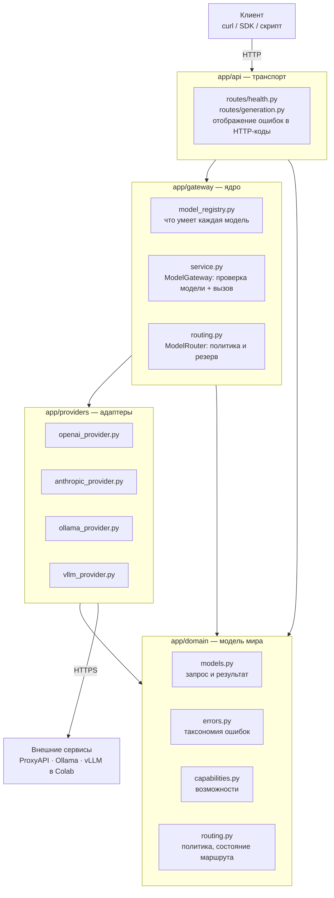

# 2. Архитектура

## Слои



Стрелки — только вниз. `domain` не импортирует ничего из проекта: это чистые модели данных и
исключения. Благодаря этому ядро и адаптеры тестируются без сети, а `domain` можно переиспользовать.

Проверить правило можно двумя командами — обе должны дать **пустой** вывод:

```bash
# домен не знает о верхних слоях
grep -rnE '^\s*(from|import)\s+app\.(gateway|providers|api)' app/domain/

# ядро не импортирует SDK поставщиков
grep -rnE '^\s*(from|import)\s+(openai|anthropic|httpx2?)' app/gateway/
```

Импорты внутри самого домена — норма: `app/domain/routing.py` берёт `Message` из
`app/domain/models.py`. Запрещены только зависимости снизу вверх.

## Модули и их ответственность

| Модуль | Ответственность | Чего здесь быть не должно |
|---|---|---|
| [main.py](../main.py) | собрать `FastAPI`, подключить роутеры | логики шлюза |
| [app/api/routes/generation.py](../app/api/routes/generation.py) | HTTP-форма, коды ошибок, сборка объектов | знания особенностей SDK |
| [app/gateway/service.py](../app/gateway/service.py) | `ModelGateway`: одна модель, проверка имени, делегирование адаптеру | политики выбора поставщика |
| [app/gateway/model_registry.py](../app/gateway/model_registry.py) | статический реестр: имя модели и набор возможностей | сетевых вызовов |
| [app/gateway/routing.py](../app/gateway/routing.py) | `ModelRouter`: порядок кандидатов, попытки, резерв | форматирования ответа для клиента |
| [app/providers/*](../app/providers) | перевод контракта в API поставщика и обратно, включая ошибки | решений о повторах |
| [app/domain/*](../app/domain) | типы, инварианты, исключения | ввода-вывода |

Разделение `ModelGateway` и `ModelRouter` — важная деталь. `ModelGateway` — про **одну** модель:
он умеет ровно «сгенерируй этой моделью» и отказывается, если просят другую
([app/gateway/service.py](../app/gateway/service.py#L24-L29)). `ModelRouter` — про **выбор** между
несколькими шлюзами. Такое разделение позволяет использовать одиночный шлюз там, где резерв не нужен,
и не тащить в него политику ([app/api/routes/generation.py](../app/api/routes/generation.py#L108-L125)).

## Точки расширения

### Новый поставщик

Три шага, ни один не требует правок в ядре:

1. Класс с атрибутом `name` и методом `generate`, возвращающий `GenerationResult`
   ([app/providers/base.py](../app/providers/base.py)).
2. Описание возможностей в [app/gateway/model_registry.py](../app/gateway/model_registry.py)
   — с честным `verified`.
3. Регистрация клиента в словаре `gateways`
   ([app/api/routes/generation.py](../app/api/routes/generation.py#L41-L80)) и добавление имени
   в `ProviderName`.

Если задаться целью обойтись без правок `generation.py`, понадобится фабрика провайдеров —
но для четырёх поставщиков явный словарь читается лучше, чем магия импорта по строке.

### Новая возможность модели

Добавить поле в `ModelCapabilities` ([app/domain/capabilities.py](../app/domain/capabilities.py#L21-L31)),
заполнить в реестре и — если она обязательна для запроса — проверить её перед вызовом так же, как
сейчас проверяется `text_generation` ([app/gateway/routing.py](../app/gateway/routing.py#L117-L123)).

### Новая политика маршрутизации

Положить файл `policies/routing-v2.json`, поменять `POLICY_PATH`
([app/gateway/routing.py](../app/gateway/routing.py#L19-L20)) и записать решение в
[decisions/](../decisions) по образцу [routing-v1.md](../decisions/routing-v1.md).

## Почему это работает как учебный материал

В шлюзе около 1 200 строк (ещё около 700 — скрипты экспериментов), и почти каждая строка
обслуживает один из принципов. Нет слоя
«инфраструктура», нет ORM, нет кешей — поэтому весь путь запроса виден целиком. Единственное
место, где сложность настоящая, — границы с внешними API, и именно там сосредоточены все адаптеры.

Обратная сторона: отсутствие тестов. Проверка поведения выполнялась смоук-запросами к живому
сервису, а не автотестами, — это первое, что стоит добавить при возобновлении проекта.

## Вопросы для самопроверки

1. Почему `domain` не импортирует `pydantic`-модели поставщиков?
   <sub>Потому что тогда домен зависел бы от SDK, и смена версии `openai` ломала бы ядро.</sub>
2. В каком слое место кешу ответов? Аргументируйте.
   <sub>В ядре (`ModelGateway`) или в API-слое, но не в адаптере: кеш — свойство шлюза, а не
   поставщика. Ключ кеша должен включать модель, промпт и параметры.</sub>
3. Что произойдёт, если `ModelRouter` передать пустой словарь `gateways`?
   <sub>Конструктор упадёт с `RoutingConfigurationError`: для каждого кандидата вызывается
   `_get_gateway` ([app/gateway/routing.py](../app/gateway/routing.py#L52-L53)).</sub>
4. Где находится единственное место, знающее, как называется файл политики?
   <sub>`POLICY_PATH` в [app/gateway/routing.py](../app/gateway/routing.py#L19-L20).</sub>
