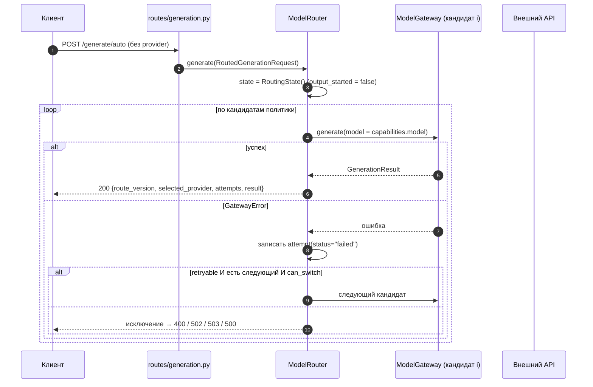

# 3. Жизненный цикл запроса

Один HTTP-запрос проходит через четыре роли. Разберём оба эндпоинта, потому что разница между
ними — это и есть разница между «шлюз» и «шлюз с маршрутизацией».

## A. Прямой вызов: `POST /generate?provider=openai`

```mermaid
sequenceDiagram
    autonumber
    participant C as Клиент
    participant F as FastAPI + Pydantic
    participant R as routes/generation.py
    participant G as ModelGateway
    participant P as OpenAIProvider
    participant X as Внешний API

    C->>F: POST /generate?provider=openai + JSON
    F->>F: проверка схемы GenerationRequest
    alt схема неверна
        F-->>C: 422 (обработчик не вызван)
    end
    F->>R: generate(request, provider)
    R->>G: gateways["openai"].generate(request)
    G->>G: request.model == capabilities.model ?
    alt модель не та
        G-->>R: UnsupportedModelError
        R-->>C: 400 {"message":..., "retryable": false}
    end
    G->>P: provider.generate(request)
    P->>P: system → instructions, user/assistant → input
    P->>X: responses.create(...)
    alt ошибка SDK
        X-->>P: исключение
        P-->>R: один из пяти типов GatewayError
        R-->>C: 400 / 502 / 503
    end
    X-->>P: ответ
    P->>P: ответ → GenerationResult (usage, finish_reason)
    P-->>G-->>R-->>C: 200 GenerationResult
```

По шагам, с точками в коде:

| # | Что происходит | Код |
|---|---|---|
| 1 | Pydantic валидирует тело. `extra="forbid"`, `messages` непустой, `max_output_tokens > 0` | [app/domain/models.py](../app/domain/models.py#L19-L24) |
| 2 | FastAPI валидирует `provider` как `Literal["openai","anthropic","ollama","vllm"]`; иначе 422 | [app/api/routes/generation.py](../app/api/routes/generation.py#L31), [#L108-L112](../app/api/routes/generation.py#L108-L112) |
| 3 | Выбирается уже созданный шлюз из словаря | [app/api/routes/generation.py](../app/api/routes/generation.py#L114) |
| 4 | `ModelGateway` сверяет запрошенное имя модели с тем, что настроено у поставщика | [app/gateway/service.py](../app/gateway/service.py#L24-L29) |
| 5 | Адаптер переводит контракт в API поставщика | [app/providers/openai_provider.py](../app/providers/openai_provider.py#L29-L52) |
| 6 | Исключения SDK превращаются в типы `GatewayError` | [app/providers/openai_provider.py](../app/providers/openai_provider.py#L53-L71) |
| 7 | Ответ разбирается в `GenerationResult`; отсутствие текста или `usage` — тоже ошибка | [app/providers/openai_provider.py](../app/providers/openai_provider.py#L73-L95) |
| 8 | Домен-исключения отображаются в HTTP-коды | [app/api/routes/generation.py](../app/api/routes/generation.py#L113-L125) |

Ключевая проверка на шаге 4 стоит отдельного внимания. Шлюз не пропускает произвольную строку
в API: если в конфигурации поставщика модель `openai/gpt-6-luna`, запрос с `openai/gpt-4` получит
`400`, а не «дорогой сюрприз». Реальный ответ этой конфигурации:

```json
{
  "detail": {
    "message": "Модель not-my-model не настроена для поставщика ollama. Ожидается qwen3:0.6b-q4_K_M",
    "retryable": false
  }
}
```

Так шлюз превращает ошибку конфигурации в явный отказ: одна модель на поставщика, никакой
неявной подмены.

## B. Маршрутизация: `POST /generate/auto`



Порядок кандидатов берётся из файла, а не из кода:

```json
{"version": "routing-v1", "candidates": ["openai", "anthropic"], "max_attempts": 2}
```

[policies/routing-v1.json](../policies/routing-v1.json)

Отсюда два следствия, которые полезно разобрать руками:

- `max_attempts: 1` отключает резерв, не меняя ни строки Python;
- `candidates` обрезается до `max_attempts`
  ([app/gateway/routing.py](../app/gateway/routing.py#L43-L45)), поэтому «три кандидата, две попытки» —
  валидная политика, а вот дубликаты в списке — ошибка конфигурации
  ([app/gateway/routing.py](../app/gateway/routing.py#L47-L50)).

Ответ содержит журнал попыток. При успехе первого кандидата он короткий; при отказе — длинный:

```json
{
  "route_version": "routing-v1",
  "selected_provider": "anthropic",
  "attempts": [
    {"provider": "openai", "status": "failed", "error": "Поставщик openai временно недоступен"},
    {"provider": "anthropic", "status": "completed", "error": null}
  ],
  "result": {"provider": "anthropic", "model": "...", "text": "...", "usage": {...}, "finish_reason": "..."}
}
```

<sub>Этот ответ собран по коду: успешный прогон в этой конфигурации вернул один attempt —
`openai`, `completed`. Отказ требует недоступности поставщика.</sub>

`selected_provider` и `attempts` — то, что делает резерв наблюдаемым. Без них клиент не отличил бы
«всё хорошо» от «первый поставщик лежал, мы потеряли две секунды».

## Один запрос — две проверки конфигурации

До первого сетевого вызова происходит две проверки, и обе могут отказать раньше, чем кто-либо
потратит деньги:

1. **Политика.** Файл читается один раз — в момент импорта роутера
   ([app/api/routes/generation.py](../app/api/routes/generation.py#L82-L85) вызывает
   `load_routing_policy()` из [app/gateway/routing.py](../app/gateway/routing.py#L23-L32));
   битый JSON, отсутствующий поставщик или неподтверждённая генерация текста — отказ старта,
   а не 500 на живом трафике.
2. **Возможности.** Каждый кандидат обязан иметь
   `text_generation.verified == "supported"`
   ([app/gateway/routing.py](../app/gateway/routing.py#L117-L123)). Модель, у которой возможность
   только заявлена, в маршрут не попадёт.

## Что происходит при ошибке: три уровня

| Уровень | Пример | Кто ловит | Результат |
|---|---|---|---|
| Схема | пустой `messages` | Pydantic до обработчика | `422`, структура ошибок FastAPI |
| Контракт шлюза | чужая модель, отсутствующий поставщик в политике | ядро | `400` / `500` с `{"message","retryable"}` |
| Поставщик | 429, 500, таймаут, невалидный ключ | адаптер → ядро | `503` / `502` / `400` |

Разбор таксономии — в [docs/07-errors.md](07-errors.md).

## Вопросы для самопроверки

1. Клиент отправил `{"model": "openai/gpt-6-luna", "messages": [{"role":"user","content":"   "}]}`.
   Что вернёт шлюз и почему?
   <sub>Запрос пройдёт валидацию и уйдёт поставщику: `content` из трёх пробелов имеет длину 3,
   а `Field(min_length=1)` проверяет длину, а не смысл. `422` будет только при `""` — пустой
   строке. Это стоит знать: «непустая строка» и «осмысленное сообщение» — разные вещи.</sub>
2. Почему `/generate/auto` не принимает параметр `model`?
   <sub>Потому что модель — свойство поставщика из реестра. `RoutedGenerationRequest`
   ([app/domain/routing.py](../app/domain/routing.py#L30-L34)) содержит только сообщения и лимит:
   иначе клиент смог бы просить модель, которой нет в политике.</sub>
3. Что случится с маршрутом, если адаптер вернёт `None` вместо `GenerationResult`?
   <sub>Упадёт `AttributeError` уже вне `except GatewayError`, то есть клиент получит `500` без
   `retryable`. Это дыра в контракте: адаптер обязан возвращать модель или бросать `GatewayError`.</sub>
4. Сколько раз за жизнь процесса читается `policies/routing-v1.json`?
   <sub>Один — при импорте `app/api/routes/generation.py`. Поэтому правка политики требует перезапуска.</sub>
